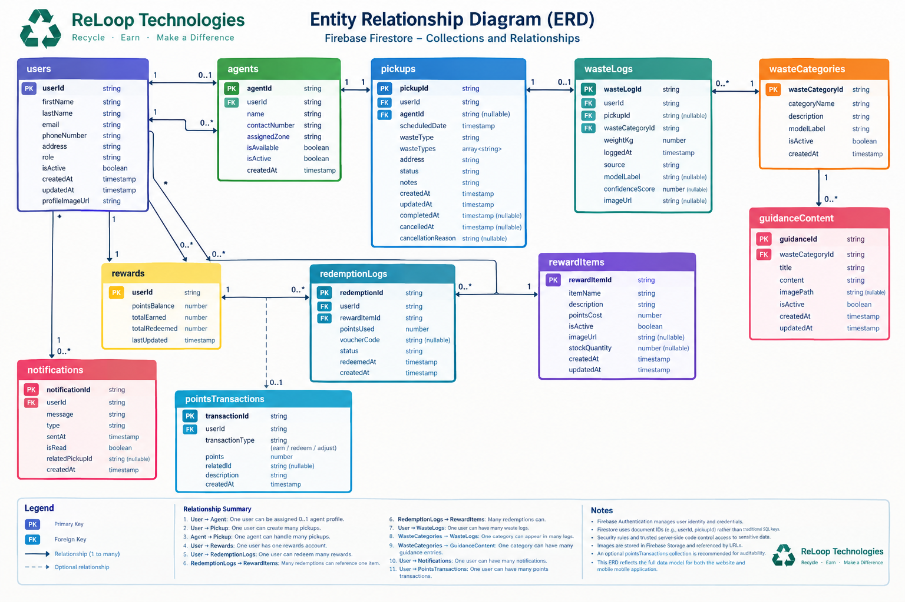
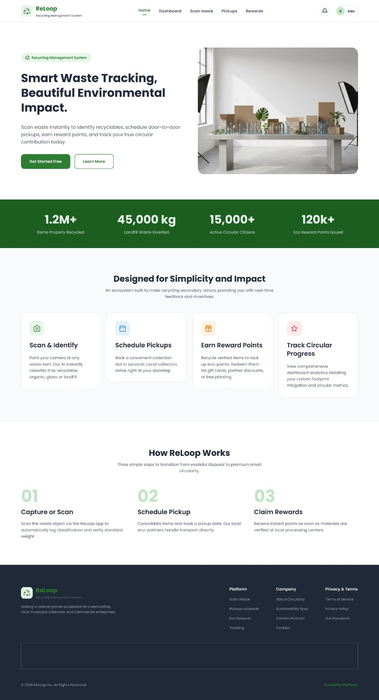
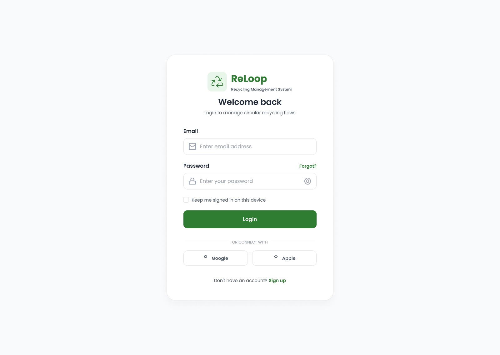
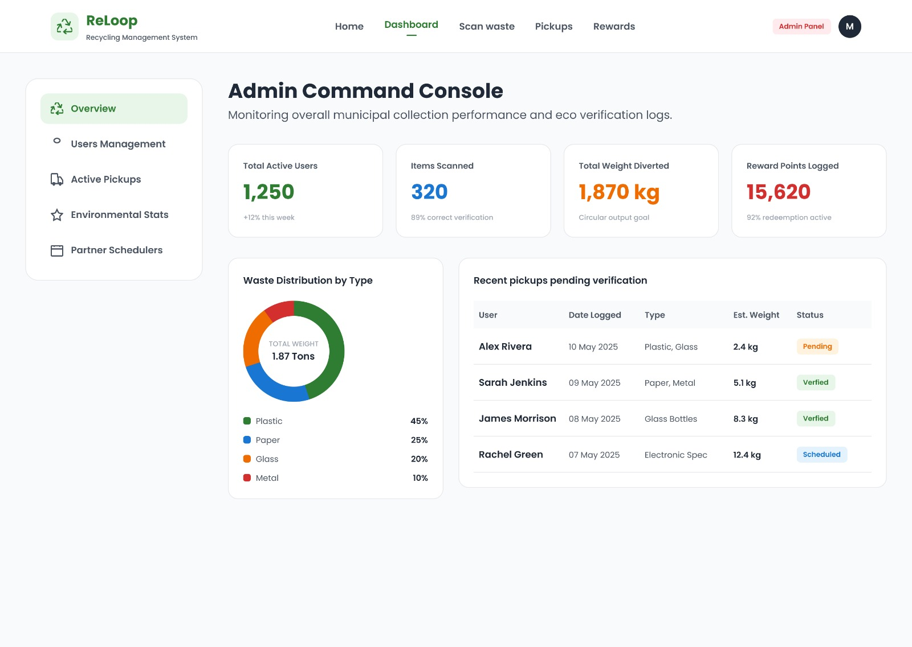
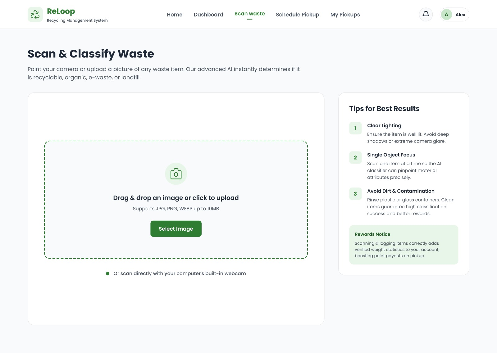
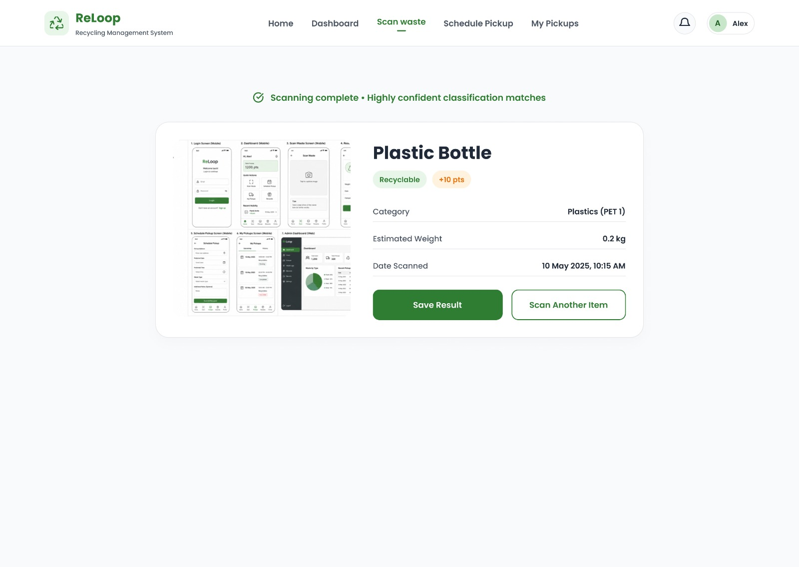
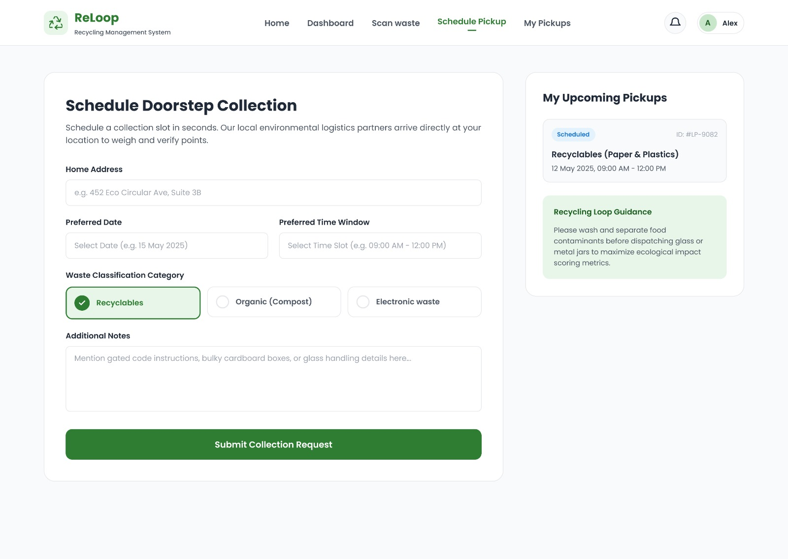
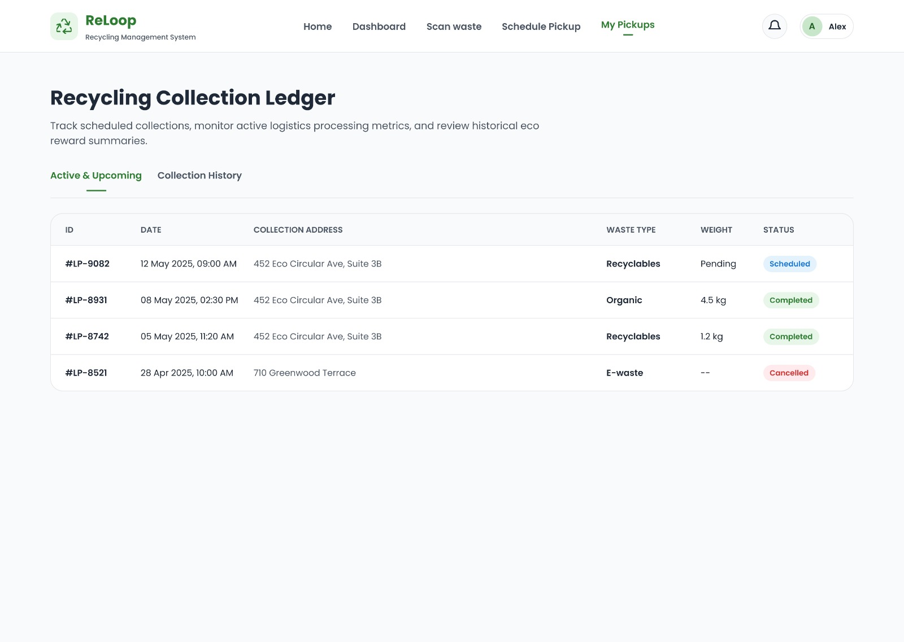

# ReLoop Technologies Web App

ReLoop is a recycling management web application built with ASP.NET Core Razor Pages. It supports Firebase Authentication, waste scan classification, pickup scheduling, pickup history, rewards, administrator management, and Cloud Firestore persistence shared with the mobile app.

## Features

- Landing page based on the ReLoop visual design.
- Login and sign-up pages with client-side and API validation.
- User dashboard with impact metrics, activity, quick actions, and upcoming pickups.
- Waste scan upload flow with classification result details.
- Doorstep pickup scheduling form with category selection and validation.
- Pickup ledger with status filtering.
- Admin command console with KPIs, waste distribution, and verification rows.
- REST API endpoints for authentication, member profiles, pickups, rewards/redemptions, notifications, waste guidance, contact, and administrator operations/reports.
- Firebase Authentication (Email/Password), server-verified Firebase ID tokens, and an HTTP-only application session cookie.
- Cloud Firestore persistence shared with the mobile app.
- Administrator-only management pages and endpoints.
- A repeatable, opt-in demo-data seeder for the ERD collections.
- xUnit tests and GitHub Actions workflows for CI and optional Cloud Run deployment.

## Tech Stack

- ASP.NET Core Razor Pages
- .NET 8
- Firebase Authentication
- Cloud Firestore
- Bootstrap assets and project CSS
- xUnit, ASP.NET Core TestHost, in-memory document store for tests

## Run Locally

The website runs locally without deploying it to Google Cloud. From the repository directory, run:

```powershell
dotnet restore
dotnet run --project ReLoop_Technologies_Web_App.csproj
```

Keep that terminal open while using the site. The app uses Firebase Authentication and the shared Firestore project, so local records are stored in the cloud Firestore database rather than in a local database.

The project launch settings use:

```text
http://localhost:5197
https://localhost:7036
```

If that port is already being used, run:

```powershell
dotnet run --urls http://localhost:5299
```

## Firebase Configuration

The shared Firebase project ID is `relooptechnologies-2eda2`; the app uses the `(default)` Firestore database. The Firebase web-app configuration is public client configuration. The server accesses Firestore using Google Application Default Credentials (ADC) locally and a hosting identity when deployed. Never commit a service-account JSON key.

```text
dotnet user-secrets set "Firebase:WebApiKey" "<Firebase web API key>"
dotnet user-secrets set "Firebase:WebAppId" "<Firebase web app ID>"
dotnet user-secrets set "Firebase:AuthDomain" "<Firebase auth domain>"
```

Run these commands in a terminal opened at the repository directory, replacing each placeholder with the corresponding value from the Firebase web app configuration. The project already has a User Secrets ID, so `dotnet user-secrets init` is not needed. Alternatively, provide `Firebase__WebApiKey`, `Firebase__WebAppId`, and `Firebase__AuthDomain` as environment variables.

For local Firestore access, install the Google Cloud CLI and sign in with Application Default Credentials if this has not already been done:

```powershell
gcloud auth application-default login
```

The signed-in Google account must have permission to access Firestore in the shared project. This login is for the local server's database access; it does not deploy the app. Firebase Authentication and Firestore have their own usage limits and plan terms.

The app does not create Firebase resources. Firebase Authentication, the Firestore database, and access permissions must already be configured in the Firebase/Google Cloud project. Firebase web API key and app ID are not server secrets, but must correspond to this project.

The data model is documented in `Data/FirestoreDocuments.cs` and matches the shared ERD. Firestore security rules are in [firestore.rules](firestore.rules); composite indexes are in [firestore.indexes.json](firestore.indexes.json). The server uses Admin SDK/service credentials and must enforce authorization in the application; these client rules do not restrict trusted server credentials.

## Optional Cloud Run Deployment

Cloud Run is optional. It is not required to run the app locally or to use Firebase Authentication and Firestore. Google Cloud deployment requires a billing-enabled Google Cloud project and can incur charges; do not configure or enable it if you cannot accept that possibility. See [Cloud Run pricing](https://cloud.google.com/run/pricing).

The workflow in `.github/workflows/deploy-cloud-run.yml` runs tests and then deploys pushes to `all-updates`. It requires Google Cloud APIs, Cloud Run identities, and GitHub Workload Identity Federation to be configured first. It uses GitHub OIDC rather than a downloaded service-account key. Its repository Actions variables are:

- `GCP_WORKLOAD_IDENTITY_PROVIDER`
- `GCP_DEPLOY_SERVICE_ACCOUNT`
- `GCP_RUNTIME_SERVICE_ACCOUNT`
- `GCP_REGION`
- `CLOUD_RUN_SERVICE`
- `FIREBASE_WEB_API_KEY`
- `FIREBASE_WEB_APP_ID`
- `FIREBASE_AUTH_DOMAIN`

The Cloud Run runtime identity needs Firestore access. Firebase web configuration values are public client configuration; never place a service-account JSON key in GitHub or this repository. If Cloud Run is not configured, the deployment part of this workflow will fail; the local app and Firebase data are unaffected.

## Demo Data

The demo seed utility can create five clearly prefixed sample documents in each of the 11 ERD collections (55 documents total). It creates no Firebase Authentication accounts or administrators. It is never run automatically and skips already-existing demo IDs. Run it locally after ADC is configured; preview first:

```powershell
dotnet run --project tools/FirestoreDemoSeed -- --project-id relooptechnologies-2eda2
```

Only after reviewing the dry-run output, explicitly write the 55 demo documents to the shared Firestore project:

```powershell
dotnet run --project tools/FirestoreDemoSeed -- --project-id relooptechnologies-2eda2 --apply --confirm-live-demo-data
```

Demo user records use `example.invalid` email addresses and cannot sign in. Do not promote them to administrators. Create a real Firebase Authentication account for any administrator and assign its role through the authorized project-owner/admin process. Ask for the first-admin setup steps before changing roles in Firestore.

## Shared Firestore Data Model

The ERD below is the Firestore collection model shared by the website and its mobile counterpart.



## Testing

Run all tests:

```powershell
dotnet test
```

The test project uses an in-memory Firestore document-store substitute and fake verified identities, so tests do not contact Firebase. The CI workflow is `.github/workflows/dotnet-ci.yml`; the optional deployment workflow also runs the tests before deploying.

The manual QA checklist is in [QA-CHECKLIST.md](QA-CHECKLIST.md).

## Wireframes

The images below are the supplied wireframes and brand references used for the implementation.

### Landing Page



### Login Page



### Admin Dashboard



### Scan Upload Page



### Scan Result Page



### Schedule Pickup Page



### Pickup Ledger Page



### App Logo


### Brand Logo


## Notes

- Firebase Auth handles passwords. The server verifies Firebase ID tokens and authorizes the secure application session against the current Firestore user role and active state.
- Scan classification is a deterministic demo classifier based on filename hints until an AI/image model is connected.
- Scan classification and points are recorded in Firestore; production image recognition still requires a connected model.

---

## Team

Work is on GitHub under [sibongiseni-ngwamba/ReLoop_Technologies_Web_App](https://github.com/sibongiseni-ngwamba/ReLoop_Technologies_Web_App).

| GitHub | Name |
| --- | --- |
| [sibongiseni-ngwamba](https://github.com/sibongiseni-ngwamba) | Sibongiseni Ngwamaba |
| [Thokozani Masondo](https://github.com/Globoysosa) | Thokozani Masondo |
| [tirisano-trigga](https://github.com/tirisanomolaolwe-byte) | Tirisano Molaolwe |
| [Katleho Kwakwari](https://github.com/Katleho-1) | Katleho Kwakwari |
| [Katlego Makhuba](https://github.com/st10366193) | Katlego Makhuba |
