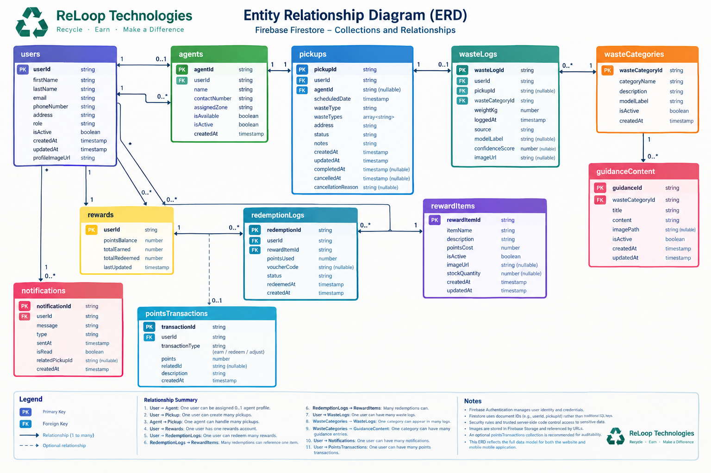

# ReLoop Technologies Web App

ReLoop is an ASP.NET Core Razor Pages web client for the same Firebase project used by the Android app. Browser sign-in uses Firebase Authentication, and application data is read from and written to the shared Cloud Firestore collections through the Firebase JavaScript SDK. The web client does not need Firebase CLI, Google CLI, a service-account key, or a deployed REST API.
ReLoop is a recycling management web application built with ASP.NET Core Razor Pages. It supports Firebase Authentication, waste scan classification, pickup scheduling, pickup history, rewards, administrator management, and Cloud Firestore persistence shared with the mobile app.

## Web Diagram 

[](https://gitdiagram.com/sibongiseni-ngwamba/reloop_technologies_web_app?utm_source=readme&utm_medium=picture)

## Features

- Landing page based on the ReLoop visual design.
- Login and sign-up pages with client-side and API validation.
- User dashboard with impact metrics, activity, quick actions, and upcoming pickups.
- Waste scan upload flow with classification result details.
- Doorstep pickup scheduling form with category selection and validation.
- Pickup ledger with status filtering.
- Admin command console with KPIs, waste distribution, and verification rows.
- REST API endpoints for authentication, member profiles, pickups, rewards/redemptions, notifications, waste guidance, contact, and administrator operations/reports.
- Firebase Authentication (Email/Password), server-verified Firebase ID tokens, and an HTTP-only application session cookie.
- Cloud Firestore persistence shared with the mobile app.
- Administrator-only management pages and endpoints.
- A repeatable, opt-in demo-data seeder for the ERD collections.
- xUnit tests and GitHub Actions workflows for CI and optional Cloud Run deployment.

## Tech Stack

- ASP.NET Core Razor Pages
- .NET 8
- Firebase Authentication
- Cloud Firestore
- Bootstrap assets and project CSS
- xUnit, ASP.NET Core TestHost, in-memory document store for tests

## Run Locally

The website runs locally without deploying it to Google Cloud. From the repository directory, run:

```powershell
dotnet restore
dotnet run --project ReLoop_Technologies_Web_App.csproj
```

Keep that terminal open while using the site. The app uses Firebase Authentication and the shared Firestore project, so local records are stored in the cloud Firestore database rather than in a local database.

The project launch settings use:

## Local setup

1. In Firebase Console, open project `relooptechnologies-2eda2`, choose **Add app → Web**, and register this site. Copy the web app configuration values. This is a browser app configuration; never use a service account or Admin SDK key here.
2. In Firebase Console → **Authentication → Sign-in method**, enable **Email/Password**. In **Authentication → Settings → Authorized domains**, add the host you use locally if it is not already listed.
3. In Firestore, keep the rules shared with the Android app. The current web workflows use the `users`, `pickups`, `rewards`, `rewardItems`, `redemptionLogs`, `pointsTransactions`, `wasteLogs`, and `contactMessages` collections. Admin access comes from the signed-in user’s `users/{uid}.role == "admin"` profile and is enforced by Firestore rules. Apply the two Console-only rule additions in [`docs/firestore-admin-rule-change.md`](docs/firestore-admin-rule-change.md) to allow admins to create claims for other users and to safely accept contact messages.
4. Put the web app’s `apiKey`, `authDomain`, `projectId`, and `appId` in `appsettings.Development.json` under `Firebase`. The API key and app ID are public browser identifiers; do not put a service-account key in this file. Keep `Firebase:ProjectId` set to the shared mobile project.
5. Start the app with `dotnet run` and open the local address printed by ASP.NET Core.

Example configuration shape:

```json
{
  "Firebase": {
    "ApiKey": "your-web-api-key",
    "AuthDomain": "your-project.firebaseapp.com",
    "ProjectId": "relooptechnologies-2eda2",
    "AppId": "1:project-number:web:web-app-id"
  }
}
```

The default repository settings intentionally leave the web API key and app ID empty until a Web app is registered in Firebase Console. Firebase configuration is injected into the page at request time; no credentials or private keys are compiled into the JavaScript file.
If that port is already being used, run:

```powershell
dotnet run --urls http://localhost:5299
```

## Firebase Configuration

The shared Firebase project ID is `relooptechnologies-2eda2`; the app uses the `(default)` Firestore database. The Firebase web-app configuration is public client configuration. The server accesses Firestore using Google Application Default Credentials (ADC) locally and a hosting identity when deployed. Never commit a service-account JSON key.

```text
dotnet user-secrets set "Firebase:WebApiKey" "<Firebase web API key>"
dotnet user-secrets set "Firebase:WebAppId" "<Firebase web app ID>"
dotnet user-secrets set "Firebase:AuthDomain" "<Firebase auth domain>"
```

Run these commands in a terminal opened at the repository directory, replacing each placeholder with the corresponding value from the Firebase web app configuration. The project already has a User Secrets ID, so `dotnet user-secrets init` is not needed. Alternatively, provide `Firebase__WebApiKey`, `Firebase__WebAppId`, and `Firebase__AuthDomain` as environment variables.

For local Firestore access, install the Google Cloud CLI and sign in with Application Default Credentials if this has not already been done:

```powershell
gcloud auth application-default login
```

The signed-in Google account must have permission to access Firestore in the shared project. This login is for the local server's database access; it does not deploy the app. Firebase Authentication and Firestore have their own usage limits and plan terms.

The app does not create Firebase resources. Firebase Authentication, the Firestore database, and access permissions must already be configured in the Firebase/Google Cloud project. Firebase web API key and app ID are not server secrets, but must correspond to this project.

The data model is documented in `Data/FirestoreDocuments.cs` and matches the shared ERD. Firestore security rules are in [firestore.rules](firestore.rules); composite indexes are in [firestore.indexes.json](firestore.indexes.json). The server uses Admin SDK/service credentials and must enforce authorization in the application; these client rules do not restrict trusted server credentials.

## Optional Cloud Run Deployment

Cloud Run is optional. It is not required to run the app locally or to use Firebase Authentication and Firestore. Google Cloud deployment requires a billing-enabled Google Cloud project and can incur charges; do not configure or enable it if you cannot accept that possibility. See [Cloud Run pricing](https://cloud.google.com/run/pricing).

The workflow in `.github/workflows/deploy-cloud-run.yml` runs tests and then deploys pushes to `all-updates`. It requires Google Cloud APIs, Cloud Run identities, and GitHub Workload Identity Federation to be configured first. It uses GitHub OIDC rather than a downloaded service-account key. Its repository Actions variables are:

- `GCP_WORKLOAD_IDENTITY_PROVIDER`
- `GCP_DEPLOY_SERVICE_ACCOUNT`
- `GCP_RUNTIME_SERVICE_ACCOUNT`
- `GCP_REGION`
- `CLOUD_RUN_SERVICE`
- `FIREBASE_WEB_API_KEY`
- `FIREBASE_WEB_APP_ID`
- `FIREBASE_AUTH_DOMAIN`

The Cloud Run runtime identity needs Firestore access. Firebase web configuration values are public client configuration; never place a service-account JSON key in GitHub or this repository. If Cloud Run is not configured, the deployment part of this workflow will fail; the local app and Firebase data are unaffected.

## Demo Data

The demo seed utility can create five clearly prefixed sample documents in each of the 11 ERD collections (55 documents total). It creates no Firebase Authentication accounts or administrators. It is never run automatically and skips already-existing demo IDs. Run it locally after ADC is configured; preview first:

```powershell
dotnet run --project tools/FirestoreDemoSeed -- --project-id relooptechnologies-2eda2
```

Only after reviewing the dry-run output, explicitly write the 55 demo documents to the shared Firestore project:

```powershell
dotnet run --project tools/FirestoreDemoSeed -- --project-id relooptechnologies-2eda2 --apply --confirm-live-demo-data
```

Demo user records use `example.invalid` email addresses and cannot sign in. Do not promote them to administrators. Create a real Firebase Authentication account for any administrator and assign its role through the authorized project-owner/admin process. Ask for the first-admin setup steps before changing roles in Firestore.

## Shared Firestore Data Model

The ERD below is the Firestore collection model shared by the website and its mobile counterpart.



## Testing

Run all tests:

```powershell
dotnet test
```

The test project uses an in-memory Firestore document-store substitute and fake verified identities, so tests do not contact Firebase. The CI workflow is `.github/workflows/dotnet-ci.yml`; the optional deployment workflow also runs the tests before deploying.

The manual QA checklist is in [QA-CHECKLIST.md](QA-CHECKLIST.md).

## Web features

- Email/password registration and sign-in through Firebase Authentication.
- User profile, pickup schedule/history, dashboard metrics, demo scan records, and contact messages in Firestore.
- Role-checked admin console for user roles/activation, pickup status, rewards catalogue, redemption claim status, and scan records.
- Existing ReLoop landing, about, contact, and account pages.

The waste classifier remains a filename-based demonstration; it is not an image recognition model. Firebase access requires the Firestore rules and Authentication settings in the shared project to permit the signed-in role and domain.

## Admin setup and controls

Create the admin account in the web or Android app first. In Firebase Console → **Firestore Database → Data**, open `users/{that account's Firebase Auth UID}` and set its `role` field to the string `admin`. Admin screens are hidden behind a profile-role check, and Firestore rules remain the actual authorization boundary. Never make the admin role self-editable for ordinary users.

The mobile Firestore rules currently allow signed-in admins to manage users, pickups, reward items, and redemption logs. They also allow members to change their own reward balances and create their own points transactions; this is a known mobile-side security limitation for reward value. Do not treat client-side reward points as monetary value until reward mutations move behind trusted server-side validation.

## Tests

Run the .NET rendered-page and API integration tests with `dotnet test`, and run the browser-domain unit tests with `node --test tests/javascript/*.test.cjs`. These tests do not need Firebase credentials. The admin page smoke check covers its management sections; live Firebase access still requires manual verification with a configured Firebase project and test accounts.

The GitHub Actions workflow in `.github/workflows/dotnet-ci.yml` only builds and runs tests. It does not deploy the web app or change Firebase data. There are no Firebase, Google Cloud, or Supabase deployment workflows in this repository.

## Design references

The original UI wireframes are under [`docs/wireframes`](docs/wireframes).

## Application Screenshots

| | |
|---|---|
| <br>**Landing page** — Overview of ReLoop and its recycling features. | <br>**About page** — Mission, workflow, and impact model. |
| <br>**Contact form** — Support contact details and message form. | <br>**How it works** — Three steps from scanning to rewards. |
| <br>**Login form** — Email and password sign-in. | <br>**Login options** — Google sign-in alongside the login form. |
| <br>**Sign-up form** — Create an account with name, email, and password. | <br>**Sign-up options** — Google sign-in alongside account creation. |
| <br>**Profile** — Account details and recycling summary. | <br>**Dashboard** — Reward points, scan totals, and pickup activity. |
| <br>**Dashboard activity** — Recent activity and upcoming pickups. | <br>**Waste scanning** — Upload an item image for classification. |
| <br>**Scan guidance** — Tips and reward information for scans. | <br>**Schedule pickup** — Choose an address, date, time, and waste type. |
| <br>**Pickup notes** — Add collection instructions and submit a request. | <br>**Pickup ledger** — Filter and review collection history. |
| <br>**Pickup record** — Example scheduled collection in the ledger. | |

## Demo Video

[Watch or download the ReLoop demo video](assets/Demo%20Video.mp4).

[Watch the ReLoop demo video Youtube Video](https://youtu.be/xLQWkZXzUnc?si=SZLBqO0JhmwX5cy6)

https://youtu.be/xLQWkZXzUnc?si=SZLBqO0JhmwX5cy6

- Firebase Auth handles passwords. The server verifies Firebase ID tokens and authorizes the secure application session against the current Firestore user role and active state.
- Scan classification is a deterministic demo classifier based on filename hints until an AI/image model is connected.
- Scan classification and points are recorded in Firestore; production image recognition still requires a connected model.

---

## Team

Work is on GitHub under [sibongiseni-ngwamba/ReLoop_Technologies_Web_App](https://github.com/sibongiseni-ngwamba/ReLoop_Technologies_Web_App).

| GitHub | Name |
| --- | --- |
| [sibongiseni-ngwamba](https://github.com/sibongiseni-ngwamba) | Sibongiseni Ngwamaba |
| [Thokozani Masondo](https://github.com/Globoysosa) | Thokozani Masondo |
| [tirisano-trigga](https://github.com/tirisanomolaolwe-byte) | Tirisano Molaolwe |
| [Katleho Kwakwari](https://github.com/Katleho-1) | Katleho Kwakwari |
| [Katlego Makhuba](https://github.com/st10366193) | Katlego Makhuba |
